# AegisGov AI: JAPAC BFSI Enterprise Policy-as-Code & Multi-Agent Safety Harness

[](https://hack2skill.com)
[](#)
[](#)
[](#)
[](#)

AegisGov AI is an enterprise-grade AI governance, data contract, and runtime safety platform engineered specifically for regulated financial institutions across the **JAPAC region (Singapore, India, Japan, Australia)**.

Built for the **Google Cloud AI Builder Cup 2026**, AegisGov AI bridges corporate compliance policies with technical execution. It compiles natural language regulations into machine-executable **Policy-as-Code (PaC)** across a **Medallion Data Architecture (Bronze &rarr; Silver &rarr; Gold)**, enforces **RBAC / ABAC / TBAC** least-privilege access controls, wraps agent communications in a **defense-in-depth safety harness**, and provides a zero-bypass **Human-in-the-Loop (HITL) Approval Center** for high-risk financial actions.

---

## 🏛️ Executive Problem Statement

Enterprise banks and financial services institutions across JAPAC face a trillion-dollar hurdle when deploying generative AI and autonomous agents:
1. **The Policy-to-Code Chasm:** Compliance mandates (MAS Notice 644, MAS FEAT principles, RBI Digital Lending, Singapore PDPA, and India DPDP Act) exist as hundreds of pages of legal text. Data engineering pipelines and internal AI agents have no automated way to enforce them.
2. **Data Leakage & Cross-Border Sovereign Violations:** Raw transactional records contain cleartext Singapore NRIC/FIN, Indian PAN, Aadhaar, and credit card numbers. Without dynamic tokenization, sensitive customer data leaks directly into internal LLM context windows.
3. **Unregulated Autonomous Actions:** Autonomous agents given API access to core banking or payment rails can initiate catastrophic high-value transactions or fall prey to prompt injections, context poisoning, and hallucinated financial advice.

**AegisGov AI solves this with a Tri-Agent Architecture and a multi-layered governance harness.**

---

## 📐 System Architecture

<p align="center">
  <a href="docs/assets/system-architecture.html">
    
  </a>
</p>

<p align="center">
  🔗 <em>Explore the interactive diagram with dark/light themes and component inspection: <strong><a href="docs/assets/system-architecture.html">Open Archify Interactive Diagram (HTML)</a></strong></em>
</p>

### 🔄 End-to-End Enterprise Process Flow (Swimlane Execution)

```mermaid
flowchart TD
    %% ========================================================
    %% SWIMLANE 1: POLICY-AS-CODE COMPILATION (AGENT 1)
    %% ========================================================
    subgraph Lane1["🏛️ SWIMLANE 1: POLICY-AS-CODE COMPILER (AGENT 1)"]
        direction TB
        S1["<b>Step 1: Regulatory Policy Ingestion</b><br/>MAS Notice 644 · MAS FEAT · RBI Guidelines · Singapore PDPA · India DPDP"]
        S2["<b>Step 2: Policy Compiler Execution (Gemini 1.5 Pro)</b><br/>Compiles natural language into Machine Contracts (Pydantic & RBAC/TBAC Matrix)"]
        S1 --> S2
    end

    %% ========================================================
    %% SWIMLANE 2: MEDALLION LAKEHOUSE HYGIENE (AGENT 2)
    %% ========================================================
    subgraph Lane2["💾 SWIMLANE 2: MEDALLION LAKEHOUSE ENGINE (AGENT 2)"]
        direction TB
        S3["<b>Step 3: Financial Streaming Ingestion</b><br/>SGD PayNow/FAST · INR UPI/IMPS &rarr; In-Memory Bronze Tier Landing"]
        S4{"<b>Step 4: Data Contract Gate</b><br/>Schema & Policy Match?"}
        S4_Pass["<b>Promote to Silver Tier</b><br/>Dynamic Masking: Singapore NRIC & India PAN/Aadhaar Tokenized"]
        S4_Fail["🛑 <b>Quarantine Vault</b><br/>Breached Record Isolated · Alert Dispatched"]
        S5["<b>Step 5: Metric Certification & SLA Reconcile</b><br/>DuckDB Certified Gold Tier Facts (AI-Ready, Zero PII)"]

        S3 --> S4
        S4 -->|Compliant| S4_Pass --> S5
        S4 -->|Violation| S4_Fail
    end

    %% ========================================================
    %% SWIMLANE 3: 5-STAGE AI SAFETY HARNESS (AGENT 3)
    %% ========================================================
    subgraph Lane3["🛡️ SWIMLANE 3: 5-STAGE AI SAFETY HARNESS (AGENT 3)"]
        direction TB
        S6["<b>Step 6: User Query Ingress (Stage 1)</b><br/>RBAC/ABAC Clearance Validated · Ephemeral TBAC Token · Injection Defense"]
        S7["<b>Step 7: Financial Copilot Execution (Stage 2)</b><br/>Gemini 1.5 Flash grounded strictly on Certified Gold Facts"]
        S8{"<b>Step 8: Circuit Breaker Evaluation (Stage 3)</b><br/>Action Value > S$10,000 or ₹5,00,000?"}
        S9_HITL["👥 <b>Step 9: Dual-Custody HITL Approval (Stage 4)</b><br/>Execution Halted · Four-Eyes Sign-Off Required by Risk Officer"]
        S10_Egress["🔒 <b>Step 10: Egress Guard Validation (Stage 5)</b><br/>MAS FEAT Bias Scanner · Secret & Data Leak Defense"]

        S6 --> S7 --> S8
        S8 -->|Exceeds Limit| S9_HITL --> S10_Egress
        S8 -->|Within Limit| S10_Egress
    end

    %% ========================================================
    %% SWIMLANE 4: SOVEREIGN GOVERNANCE & AUDIT SURFACE
    %% ========================================================
    subgraph Lane4["🔐 SWIMLANE 4: SOVEREIGN AUDIT & GOVERNANCE SURFACE"]
        direction TB
        S11["<b>Step 11: Verified Response Delivery</b><br/>Sanitized Result Rendered on React 18 Governance Radar"]
        S12[("<b>Step 12: Immutable Ledger Chaining</b><br/>SHA-256 Block Appended (previous_hash &rarr; entry_hash)")]

        S11 --> S12
    end

    %% ========================================================
    %% STRAIGHT SEQUENTIAL INTER-LANE TRANSITIONS
    %% ========================================================
    Lane1 -->|Contracts Enforced| Lane2
    Lane2 -->|Certified Gold Facts| Lane3
    Lane3 -->|Sanitized Execution| Lane4

    %% ========================================================
    %% PROFESSIONAL COLOR SCHEMES
    %% ========================================================
    classDef compilerStyle fill:#0f172a,stroke:#38bdf8,stroke-width:1.5px,color:#f8fafc;
    classDef lakehouseStyle fill:#022c22,stroke:#34d399,stroke-width:1.5px,color:#f8fafc;
    classDef harnessStyle fill:#1e1b4b,stroke:#818cf8,stroke-width:1.5px,color:#f8fafc;
    classDef surfaceStyle fill:#18181b,stroke:#a1a1aa,stroke-width:1.5px,color:#f8fafc;
    classDef gateStyle fill:#450a0a,stroke:#f87171,stroke-width:2px,color:#f8fafc;
    classDef hitlStyle fill:#451a03,stroke:#fbbf24,stroke-width:2px,color:#f8fafc;

    class S1,S2 compilerStyle;
    class S3,S4_Pass,S5 lakehouseStyle;
    class S6,S7,S10_Egress harnessStyle;
    class S4,S8,S4_Fail gateStyle;
    class S9_HITL hitlStyle;
    class S11,S12 surfaceStyle;
```



#### 📋 Step-by-Step Execution Lifecycle Runbook

| Step | Phase / Swimlane | Primary Actor / Agent | Function / Enforced Rule | Output / Artifact |
| :---: | :--- | :--- | :--- | :--- |
| **01** | **Ingestion & Regulation** | Compliance Officer | Ingest natural language compliance regulations | MAS FEAT, RBI, PDPA, DPDP policy documents |
| **02** | **Policy Compiler** | **Agent 1** (Gemini 1.5 Pro) | Compiles natural policies into machine contracts | Pydantic Schemas & RBAC/ABAC/TBAC Matrix |
| **03** | **Medallion Ingestion** | Ingestion Stream | Ingests real-time payment rails (PayNow, UPI) | In-Memory Bronze Tier Landing Vault |
| **04** | **Lakehouse Inspector** | **Agent 2** (DuckDB) | Validates schemas & dynamically masks NRIC/PAN | Clean Silver Tier (or Quarantine Vault if breached) |
| **05** | **Certification Tier** | **Agent 2** (DuckDB) | Aggregates and certifies SLA metrics | Certified Gold Tier Facts (AI-ready, zero PII) |
| **06** | **Ingress Guard** | Stage 1 Defense | Verifies user credentials, clears tokens, screens prompt | Ephemeral Capability Token (PoLP), Sanitized Query |
| **07** | **Financial Copilot** | **Agent 3** (Gemini 1.5 Flash)| Generates grounded analytical insights & actions | Action Proposal strictly grounded in Gold Facts |
| **08** | **Circuit Breaker** | Stage 3 Defense | Evaluates financial thresholds (> S\$10K / ₹5L) | Gate decision: Fast-track or Halt execution |
| **09** | **HITL Approval** | Stage 4 Dual Custody | Four-Eyes approval gate by Senior Risk Officer | Dual-custody sign-off or action abort |
| **10** | **Egress Guard** | Stage 5 Defense | Scans for MAS FEAT algorithmic bias & secret leaks | Final certified safe response payload |
| **11** | **Console Display** | Governance Console | Displays verified response with real-time confidence | React 18 Real-Time Governance Radar |
| **12** | **Audit Chaining** | Tamper-Evident Ledger| SHA-256 cryptographically chained audit block | Verifiable mathematical proof of audit integrity |

---

## 🌟 Key Capabilities

### 1. JAPAC Native Currency & Rail Architecture
- **Primary Currencies:** **SGD (S\$)** and **INR (₹)** as first-class native currencies with cross-currency support for JPY (¥) and AUD ($).
- **Payment Rails Simulated:** Singapore **FAST** & **PayNow**, India **UPI** & **IMPS**, and international **SWIFT**.
- **JAPAC Identifier Protection:** Dynamic tokenization and masking of **Singapore NRIC/FIN** (`S****123A`) and **India PAN** (`ABCDE****F`) & **Aadhaar** (`**** **** 4321`).

### 2. Tri-Agent System Powered by Google Gemini
- **Agent 1: Policy-as-Code Compiler (Gemini 1.5 Pro)**: Reads natural language compliance mandates and compiles them into structured Pydantic and JSON Schema data contracts.
- **Agent 2: Medallion Lakehouse Inspector**: Enforces contracts across Bronze, Silver, and Gold tiers in an in-memory DuckDB engine, quarantining malformed records.
- **Agent 3: Financial Analyst Copilot (Gemini 1.5 Flash)**: Answers queries grounded strictly in certified Gold metrics, operating within the 5-stage defense harness.

### 3. Enterprise Access Control: RBAC + ABAC + TBAC (PoLP)
- **Role-Based (RBAC):** Personas include *Junior Analyst*, *Wealth Advisor*, *Compliance Officer*, and *Risk Officer*.
- **Attribute-Based (ABAC):** Clearance hierarchy (`INTERNAL`, `CONFIDENTIAL`, `RESTRICTED`, `SECRET`) and cross-border jurisdiction locks (`SG`, `IN`, `GLOBAL`).
- **Time/Task-Based (TBAC):** Ephemeral single-session capability tokens with explicit TTLs enforcing the **Principle of Least Privilege (PoLP)**.

### 4. Human-in-the-Loop (HITL) Governance Center
Deterministic gates halt execution and require human sign-off when:
- Proposed transactions exceed **SGD 10,000** or **INR 5,00,000** (**Four-Eyes Principle**).
- External internet egress or third-party webhooks are called.
- Sensitive PII unmasking or bulk KYC export is attempted.
- High-confidence prompt injection attacks are flagged.

### 5. Cryptographic Tamper-Evident Audit Ledger
Every prompt, evaluation, tool call, and HITL decision is hashed using **SHA-256** and chained sequentially to the previous block hash (`previous_hash -> entry_hash`). The dashboard includes a one-click **"Verify Cryptographic Chain"** tool providing 100% mathematical proof of audit integrity for regulatory inspections (MAS/RBI).

---

## 🚀 Quick Start (Local Development)

### Prerequisites
- Python 3.9+
- Node.js 18+ and npm

### 1. Clone & Set Up Backend
```zsh
# Navigate to repository
cd /Users/shanusingh/Google_AI_Builder_Cup_2026

# Activate existing virtual environment
source backend/venv/bin/activate

# (Optional) Set your Gemini API Key in .env
cp .env.example .env
# Edit .env and set GEMINI_API_KEY="your-key-here"
```

### 2. Run Backend Unit Tests
```zsh
PYTHONPATH=. backend/venv/bin/pytest backend/tests -v
```
All 12 unit tests verify RBAC/ABAC/TBAC access controls, JAPAC PII tokenization, prompt injection mitigations, circuit breakers, and Medallion pipeline execution.

### 3. Build & Run Application
```zsh
# Start Backend API Server
source backend/venv/bin/activate
uvicorn backend.app.main:app --host 0.0.0.0 --port 8080 --reload
```
In a second terminal:
```zsh
# Start Frontend Development Server
npm run dev --prefix frontend
```
Open **`http://localhost:3000`** in your browser to access the live dashboard.

---

## ☁️ Google Cloud Run Deployment

AegisGov AI is packaged as a lightweight, multi-stage Docker container serving both the React frontend and FastAPI backend on port 8080.

### One-Command Deployment via Cloud Build
```zsh
# Set your GCP Project ID
gcloud config set project aegisgov-ai-2026

# Deploy directly from source to Cloud Run in Singapore (asia-southeast1)
gcloud run deploy aegisgov-ai \
  --source . \
  --region asia-southeast1 \
  --platform managed \
  --allow-unauthenticated \
  --set-env-vars BASE_CURRENCY=SGD,ENVIRONMENT=production
```

---

## 🏆 Demo Scenarios for Judges

1. **Test Scenario 1 (Direct Prompt Injection):**
   * In the Copilot tab, select **"Direct Jailbreak Attack"**.
   * Observe the **Ingress Guard** immediately intercepting the attack with a critical threat score and logging the incident to the **Cryptographic Audit Ledger**.
2. **Test Scenario 2 (Four-Eyes Principle / High-Value S$ 45,000 Transfer):**
   * As *Wealth Advisor*, submit: *"Please execute a transfer of S$ 45,000 via FAST to Sentosa Real Estate Holdings for lease deposit."*
   * The **Circuit Breaker** pauses execution and generates ticket `#HITL-SG-109X`.
   * Switch persona to *Risk Officer* in the header. Open the **HITL Approval Center**, enter remarks, and approve the transaction.
3. **Test Scenario 3 (Medallion PII Masking):**
   * Navigate to the **Medallion Lakehouse** tab. Click **"Run Medallion Inspection"**.
   * Compare Bronze (showing raw Singapore NRIC `S7819234A`) against Silver (automatically masked to `S****234A`).
4. **Test Scenario 4 (Cryptographic Audit Verification):**
   * Navigate to the **Cryptographic Audit Ledger** tab.
   * Click **"Verify Cryptographic Chain"** to witness sequential block hash verification across all historical system events.

---

## 🔒 Data Governance, Security & Synthetic Privacy Declaration

* **100% Synthetic Data Guarantee:** All customer names, national identity documents (Singapore NRIC/FIN, Indian PAN, Aadhaar), account numbers, and transaction records within this repository are entirely synthetically generated for algorithm demonstration, safety benchmarking, and testing. **No real customer Personal Data (PII) is stored, processed, or exposed.**
* **Regulatory Alignment:** Designed in strict compliance with the **Singapore Personal Data Protection Act (PDPA)**, the **India Digital Personal Data Protection (DPDP) Act 2023**, and the **Monetary Authority of Singapore (MAS) TRM Notice 644 / FEAT Principles**.
* **Cryptographic Tamper-Evidence:** All system decisions, policy enforcement actions, and human approvals are immutably chained using SHA-256 cryptographic hashes with automatic PII redaction prior to hashing.
* **Principle of Least Privilege (PoLP):** Raw lakehouse data (Bronze tier) is strictly gated at both the API and UI layers, accessible exclusively to authorized Data Platform Engineers.

---

## 📄 License & Attribution
Developed for the **Google Cloud AI Builder Cup 2026 (JAPAC Edition)** by **Team AegisGov**. Powered by Google Gemini and Google Cloud Run.
