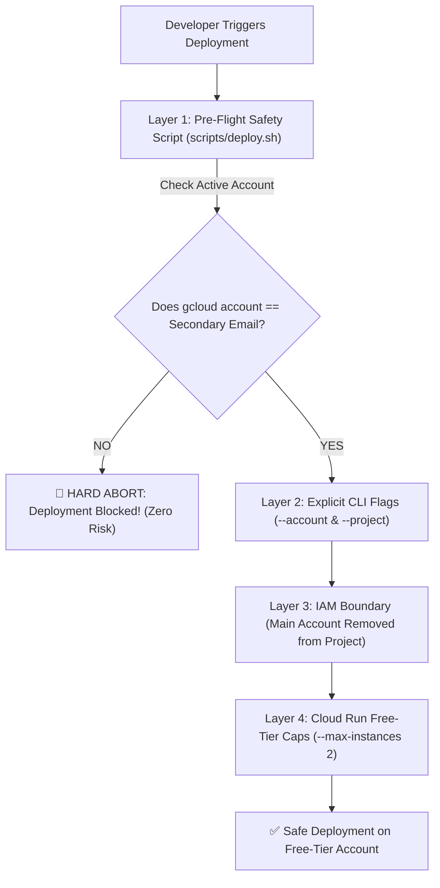

# Safe Cloud Deployment Guide: Enforcing Free-Tier Account Isolation

To ensure that all Google Cloud deployments for AegisGov AI occur **exclusively on your secondary account with free-tier credits**, and to prevent accidental resource creation on your main personal Gmail account, follow this 4-layer isolation framework.

---

## 🛡️ The 4-Layer Safety Framework



---

## 1. Configure an Isolated `gcloud` Profile

Rather than relying on the `default` gcloud configuration (which can switch ambiently), create an isolated, dedicated configuration profile named `aegisgov-freetier`:

```bash
# 1. Create a dedicated configuration
gcloud config configurations create aegisgov-freetier

# 2. Authenticate strictly with your secondary account
gcloud auth login your-free-tier-email@gmail.com

# 3. Bind the configuration to your secondary account and free-tier project
gcloud config set account your-free-tier-email@gmail.com
gcloud config set project aegisgov-ai-2026
gcloud config set compute/region asia-southeast1
gcloud config set run/region asia-southeast1

# 4. Verify the active configuration
gcloud config configurations list
```

Whenever you want to work on this project, ensure this profile is active:
```bash
gcloud config configurations activate aegisgov-freetier
```

---

## 2. Set Up Your Local `.env`

In your local [`.env`](../.env) file:

```ini
# Designated Free-Tier Account (All deployments will be strictly locked to this account)
GCP_DEPLOY_ACCOUNT="your-free-tier-email@gmail.com"
GCP_PROJECT_ID="aegisgov-ai-2026"
GCP_LOCATION="asia-southeast1"
```

---

## 3. Verify Account Safety via Script

Before executing any deployment, run our pre-flight verification script:

```bash
./scripts/verify_gcp_account.sh
```

- If your **secondary account** is active:
  ```
  ✅ VERIFICATION PASSED!
  Active account matches designated free-tier account: your-free-tier-email@gmail.com
  Safe to proceed with deployment.
  ```
- If your **main personal account** is active:
  ```
  🚨 CRITICAL SAFETY ALERT: ACCOUNT MISMATCH DETECTED!
  Your currently active gcloud account is: main-personal-email@gmail.com
  Your intended free-tier account is    : your-free-tier-email@gmail.com

  🛑 DEPLOYMENT BLOCKED TO PREVENT CHARGES ON YOUR MAIN ACCOUNT.
  ```

---

## 4. Deploying Safely via `scripts/deploy.sh`

Always deploy using the automated safe deployment script:

```bash
./scripts/deploy.sh
```

### What this script guarantees:
1. **Automated Pre-Flight Gate:** Aborts immediately if the active gcloud account does not match `GCP_DEPLOY_ACCOUNT`.
2. **Explicit Parameter Binding:** Passes `--account="your-free-tier-email@gmail.com"` and `--project="aegisgov-ai-2026"` explicitly to `gcloud builds submit` and `gcloud run deploy`. This ensures that even if gcloud switches ambient context, the commands will only execute against the secondary account.
3. **Free-Tier Protection Caps:** Automatically applies `--max-instances=2`, `--memory=512Mi`, and `--cpu=1` to keep Cloud Run strictly within Google Cloud's monthly Free Tier allowance (2 million requests/month, 180,000 vCPU-seconds free).

---

## 5. Lock Down IAM Permissions on Google Cloud Console

As a final fail-safe at the cloud API level:

1. Open the [Google Cloud Console IAM Page](https://console.cloud.google.com/iam-admin/iam) while logged into your **secondary account**.
2. Select your project (`aegisgov-ai-2026`).
3. Inspect the permissions list:
   - Ensure your **secondary email** is the **Owner**.
   - Check if your **main personal email** is listed:
     - **Remove** your main personal email from the project completely, OR ensure it only has the **Viewer** role.
4. **Why this protects you:**
   Even if you accidentally run a deployment command while logged in as your main email, Google Cloud will return a `403 PERMISSION_DENIED` error and refuse to deploy any resources or bill anything to that account!

---

## 6. Set Up a ₹100 ($1) Zero-Risk Budget Alert

In the [Google Cloud Billing Budgets & Alerts Console](https://console.cloud.google.com/billing/budgets):
1. Create a budget for your free-tier billing account with a threshold of **₹100 (or $1)**.
2. Check **Send email notifications to billing administrators** (sent to your secondary email).
3. This guarantees you are immediately alerted in the unlikely event of any unexpected resource usage.
